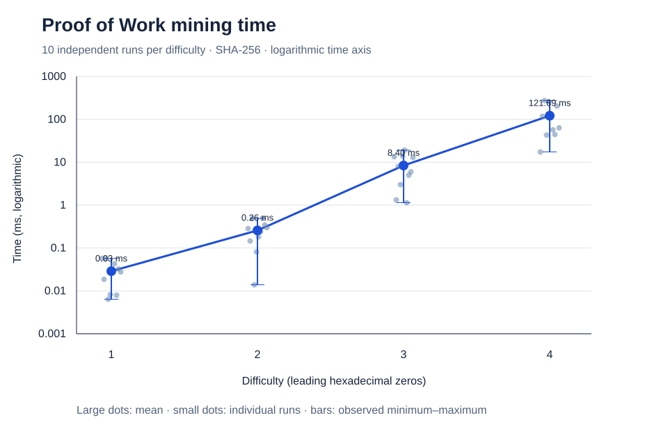

# Власний блокчейн на TypeScript

Навчальна криптовалюта з REST API, Swagger, підписами Ed25519 та Proof of Work. Логіка блокчейну написана в проєкті.

## Запуск

Потрібні Node.js 22.18 або новіший та npm.

```sh
npm install
npm run network
```

Працюють три окремі процеси: http://127.0.0.1:3001, http://127.0.0.1:3002, http://127.0.0.1:3003. У кожного свій файл `data/node-ПОРТ/chain.json`. Усі вузли вже з’єднані. `Ctrl+C` зупиняє мережу, наступний запуск відновлює ланцюги. Мемпул після перезапуску порожній.

Відкрийте http://127.0.0.1:3001/docs. Коренева адреса теж відкриває Swagger. Ключі та адреси потрібно самостійно копіювати у відповідні поля. Swagger не запам’ятовує гаманці й не змінює введені адреси після запитів.

## Налаштування середовища

За потреби створіть локальний файл налаштувань:

```sh
cp .env.example .env
```

Команди `npm run dev`, `npm start` та `npm run network` завантажують `.env`, якщо він існує. Змінні, задані під час запуску, мають пріоритет. Без `.env` використовуються стандартні локальні параметри.

| Змінна | Призначення |
| --- | --- |
| `PORT` | Порт одного вузла |
| `HOST` | Адреса прослуховування одного вузла |
| `DATA_FILE` | Шлях до файла історії одного вузла |
| `PEERS` | Адреси сусідів через кому |
| `DATA_ROOT` | Каталог історії трьох вузлів для `npm run network` |

Запуск мережі задає кожному процесу власні порт, файл історії та сусідів. Для нього з `.env` використовується `DATA_ROOT`.

`.env.example` містить лише відкриті локальні налаштування. `.env`, історія вузлів, приватні ключі, залежності та результати збірки виключені з Git. Приватні ключі гаманців генеруються під час роботи; їх не потрібно вписувати у вихідний код. Параметри консенсусу, зокрема винагорода та складність, спільні для мережі й залишаються в коді.

## Послідовність ручної перевірки

1. Створіть три гаманці через `POST /api/wallets`: відправник, отримувач і майнер. Збережіть їхні адреси та приватні ключі окремо. Створення гаманця не видає монет.
2. Виконайте `POST /api/mining`, указавши адресу відправника в `recipient`. За створений блок він отримає 50 нових монет.
3. Перевірте його адресу через `GET /api/accounts/{address}`: `balance` дорівнює 50.
4. У `POST /api/transfers` вставте приватний ключ відправника, адресу отримувача, `amount: 10`, `fee: 1`. Наступний nonce й цифровий підпис визначає сервер. Переказ потрапить у чергу.
5. Перевірте баланс відправника: `balance` ще 50, а `pendingBalance` вже 39.
6. Виконайте `POST /api/mining`, цього разу вручну вказавши адресу третього гаманця — майнера. Переказ потрапить у блок.
7. Перевірте три адреси: відправник має 39, отримувач — 10, майнер — 51. Винагорода майнера складається з 50 нових монет та комісії 1. Від отримувача нічого не списується.
8. Перегляньте `GET /api/chain` та виконайте `POST /api/chain/validate` з тілом `{}`. Сценарій додає два блоки; перевірка має повернути `valid: true`.
9. На вузлах http://127.0.0.1:3002/docs та http://127.0.0.1:3003/docs перегляньте `GET /api/chain`. Хеш останнього блока має збігатися.

Ці баланси передбачають три нові гаманці, один переказ і рівно два майнінги на зазначені адреси. Кожен майнінг створює новий блок і нову винагороду. Адреса `recipient` у переказі належить отримувачу платежу; у запиті майнінгу — отримувачу винагороди. Ці адреси можуть бути різними.

## REST API у Swagger

| Метод | Шлях | Призначення |
| --- | --- | --- |
| POST | `/api/wallets` | Створити гаманець |
| POST | `/api/mining` | Підтвердити чергу новим блоком і видати винагороду |
| POST | `/api/transfers` | Підписати й надіслати переказ одним запитом |
| GET | `/api/accounts/{address}` | Підтверджений баланс і баланс з урахуванням черги |
| GET | `/api/chain` | Показати історію |
| POST | `/api/chain/validate` | Перевірити історію |
| GET | `/api/peers` | Показати сусідів |
| POST | `/api/peers` | Під’єднати сусіда |
| DELETE | `/api/peers` | Від’єднати сусіда |
| POST | `/api/network/sync` | Звіритися із сусідами |

Тіло переказу має лише `privateKey`, `recipient`, `amount`, `fee`. Номер переказу та підпис додаються автоматично з урахуванням мемпулу. API призначений для локальної навчальної мережі; сервер слухає `127.0.0.1`.

Службові маршрути обміну транзакціями й блоками, перегляд стану та мемпулу, перевірка копії історії й окреме підписання збережені для роботи мережі, автоматичних тестів та демонстрації атак. В основному Swagger вони приховані. Старий шлях `/api/transactions` приймає готову підписану транзакцію, `/api/transactions/sign` лише підписує; це дозволяє перевіряти підробки й повторне надсилання.

Після перезапуску або відновлення зв’язку викликайте **Звірити історію із сусідами**. Фонового опитування немає; під час приймання блока, що не продовжує поточну вершину, вузол теж намагається синхронізуватися.

Для окремого запуску або нової мережі:

```sh
PORT=4001 PEERS=http://127.0.0.1:3001 DATA_FILE=data/custom/chain.json npm run dev
DATA_ROOT=/tmp/btaml-new-network npm run network
```

Для скомпільованої версії:

```sh
npm run build
PORT=4001 npm start
```

## Як працює блокчейн

Гаманець використовує Ed25519. Адреса — SHA-256 від канонічного DER-публічного ключа, представленого шістнадцятковим рядком. Приватний ключ — DER PKCS#8, також у hex.

Транзакція містить `type`, `sender`, `recipient`, `amount`, `fee`, `nonce`, `publicKey`, `signature`, `id`. Підпис покриває всі поля корисного навантаження, крім самого підпису та `id`. Ідентифікатор — SHA-256 від навантаження разом із підписом. Детермінований JSON сортує ключі на кожному рівні.

Мемпул перевіряє підпис, відповідність ключа адресі, доступні кошти з урахуванням усієї черги, наступний nonce та дублікати. Підтверджений переказ не можна повторити: його nonce вже використаний. Баланси всередині мемпулу застосовуються послідовно, тому можна витратити отриманий у попередній транзакції мемпулу переказ.

Заголовок блоку містить `height`, `timestamp`, `previousHash`, `merkleRoot`, `difficulty`, `nonce`. `hash` — SHA-256 від детерміновано серіалізованого заголовка. Час — Unix у мілісекундах. Перевірка не допускає час раніше попереднього блоку або більш ніж на хвилину в майбутньому.

Листки дерева Меркла — ідентифікатори транзакцій. Наступний рівень хешує конкатенацію двох hex-рядків. Якщо листків на рівні непарна кількість, останній дублюється. Для порожнього дерева береться SHA-256 порожнього рядка.

Майнер перебирає nonce, доки хеш не починається з потрібної кількості нулів. Кожні 2000 спроб виконання передає керування іншим запитам. Один вузол виконує лише одну операцію майнінгу одночасно. Якщо за час обчислень вершина змінилася, результат не додається: потрібно повторити запит.

Першою транзакцією йде винагорода `50 + сума комісій`. Вона прив’язана до висоти й адреси майнера. Витратити винагороду можна лише з наступного блоку. Генезис однаковий на всіх вузлах, не видає монет і не додає роботи.

Початкова складність — 2 нулі, межі — від 1 до 5. Після кожних п’яти блоків оцінюються чотири інтервали часу між ними. Орієнтир — 10 секунд на інтервал. Якщо фактичний час менший за половину очікуваного, складність зростає на 1; якщо більший за подвійний — зменшується на 1; інакше залишається без змін. Вимірювання між першим і п’ятим блоками не враховує довільну паузу перед першим блоком мережі.

Перевірка ланцюга щоразу відтворює стан із генезису: структуру й поля, хеші, PoW, посилання, висоти, час, очікувану складність, дерево Меркла, підписи, nonce, дублікати, достатність балансу та точну винагороду. Локально завантажений із файла ланцюг проходить ті самі перевірки, що й отриманий від сусіда.

Робота блока дорівнює `16^difficulty`, робота ланцюга — сумі робіт усіх блоків після генезису. Вона обчислюється через `bigint` та передається в JSON десятковим рядком. Вузол замінює свій ланцюг лише коректним кандидатом зі строго більшою роботою. За рівності зберігається локальна гілка. Довжина сама по собі не визначає переможця.

Після зміни гілки непідтверджені перекази та перекази з відкинутих блоків заново проходять перевірку мемпулу. Підтверджені у переможній гілці або конфліктні перекази відкидаються; решта повертається в чергу. Залежні перекази перевіряються повторними проходами, щоб відновити правильний порядок.

Додатково блок обмежений 100 транзакціями разом із винагородою. Із мемпулу спочатку обираються доступні для виконання транзакції з більшою комісією. Залежності балансів і порядок nonce зберігаються. Ліміт задає кількість транзакцій, а не кількість байтів.

## Модульна структура

```text
src/
  wallet/          генерація та імпорт ключів, адреси
  transactions/    підписання, перевірка, мемпул
  blocks/          заголовки, дерево Меркла, Proof of Work
  blockchain/      генезис, складність, стан, перевірка, збереження
  network/         сусіди, поширення, синхронізація
  http/            REST-маршрути, JSON, параметри сервера
  docs/            Swagger UI, OpenAPI-схеми та опис операцій
  experiment/      типи вимірювань і SVG-графік
  light-client/    заголовки та незалежна перевірка доказів Меркла
  shared/          серіалізація, перевірки значень, помилки
  main.ts          запуск одного вузла
scripts/
  network.ts       запуск трьох процесів
  demo.ts          демонстрація атак і розгалуження
  experiment.ts    вимірювання майнінгу
tests/            автоматичні перевірки
artifacts/        фактичні результати демонстрації та експерименту
```

Кожен інтерфейс розташований в окремому файлі. Одна логічна група констант — в одному файлі. Каталоги `interfaces` використані лише там, де є кілька відповідних файлів; одиночні файли лежать без зайвих вкладених папок.

## Тести та демонстрація атак

```sh
npm run check
npm test
npm run build
npm run demo
```

Демонстрація сама запускає три окремі процеси на вільних портах із тимчасовими файлами, тому не зачіпає мережу на портах 3001–3003. Після завершення процеси зупиняються, тимчасові файли видаляються. Приватні ключі залишаються лише в пам’яті процесу демонстрації.

Демонстрація виконує п’ять атак через REST API:

1. Змінює суму старого переказу — отримує `Invalid transaction signature`.
2. Змінює заголовок старого блока та заново знаходить правильний PoW — отримує `Broken previous block link` для наступного блока.
3. Надсилає підроблений підпис — отримує `Invalid transaction signature`.
4. Надсилає два різні перекази, кожен на весь доступний баланс, із послідовними nonce — другий отримує `Insufficient balance`.
5. Повторює підтверджений переказ — отримує помилку `Invalid nonce`.

Зміни історії перевіряються на копіях через `/api/chain/validate-candidate`, тож локальний файл ланцюга лишається коректним.

Потім демонстрація від’єднує всіх сусідів, створює різні гілки, відновлює зв’язки та викликає синхронізацію. Вона перевіряє повернення переказу з відкинутого блока в мемпул, включає його в наступний блок і перевіряє однакову вершину на всіх трьох вузлах. Результати з PID процесів, помилками атак, станами до й після розгалуження зберігаються в `artifacts/demo-results.json`. Цей службовий результат генерується локально й виключений із Git.

Для ручної демонстрації використовуйте DELETE `/api/peers` на обох кінцях кожного зв’язку, який потрібно розірвати. Від’єднайте обраний вузол від обох сусідів, створіть на ньому блок із переказом, а на іншій гілці — більше роботи. Відновіть зв’язки через POST `/api/peers`, викличте `/api/network/sync` на вузлі слабшої гілки та перегляньте `/api/mempool`.

## Експеримент із майнінгом

```sh
npm run experiment
```

Виконуються 20 коротких прогрівальних запусків та по 10 вимірювань для складностей 1, 2, 3, 4. Складності чергуються в кожному раунді, а кожен кандидат має новий випадковий попередній хеш. Вимірюється пошук PoW, без мережевого обміну, запису файла й перевірки всього ланцюга. Це окремі експериментальні кандидати, вони не додаються до робочої мережі.

Генеруються:

- `artifacts/mining-results.json` — усі 40 вимірювань, спроби, середні значення, вибіркове стандартне відхилення, мінімум і максимум, версія Node.js та платформа.
- `artifacts/mining-results.csv` — сирі вимірювання для подальшого аналізу.
- `artifacts/mining-time.svg` — графік середнього часу з окремими вимірюваннями та діапазоном мінімум–максимум; вісь часу логарифмічна.



Імовірність успіху одного SHA-256 для складності `d` — `16^(-d)`, а очікувана кількість спроб — `16^d`. Тому додавання одного шістнадцяткового нуля в середньому множить роботу на 16. На логарифмічній осі очікувана залежність близька до прямої. Окремі вимірювання сильно розкидані, бо кількість спроб має геометричний розподіл; на малих складностях помітні витрати запуску й вимірювання часу. Десять запусків не гарантують точного співвідношення 16 між сусідніми середніми.

Проєкт демонструє навчальний блокчейн. Довірена початкова мережа, доступ до локального API та обчислювальні ресурси не є частиною моделі п’яти перевірених атак. Зокрема, PoW сам по собі не захищає від переписування історії учасником із більшістю обчислювальної потужності.

## Додаткові завдання

Реалізовано два додаткові завдання: обмеження кількості транзакцій у блоці з відбором за комісією та доказ Меркла для легкого клієнта.

```sh
npm run block-selection
```

Ця команда перевіряє ліміт блока та відбір переказів за комісією на окремому ланцюгу в пам’яті. Із 102 переказів у перший блок потрапляє 99 та винагорода, разом 100 транзакцій. Першим обирається доступний переказ із комісією 10, решта має комісію 1. Три перекази залишаються в черзі та підтверджуються наступним блоком. Результати зберігаються локально в `artifacts/block-selection-results.json`.

Легкий клієнт запускається без додаткових файлів:

```sh
npm run light-client
```

Клієнт одразу підключається до `http://127.0.0.1:3001`. Вставте `transaction.id` із відповіді `POST /api/transfers`. Переказ має бути підтверджений майнінгом. Клієнт сам отримає один потрібний переказ і його доказ та перевірить їх. Після результату можна ввести інший ID; порожній ввід завершує роботу. Приватні ключі вводити не потрібно.

Для одноразової перевірки можна передати адресу вузла й ID аргументами. Попередній запуск із JSON-файлом переказу також підтримується, але створення файла не є обов’язковим.

Клієнт запитує лише `GET /api/headers` та `GET /api/transactions/{id}/proof`, перевіряє послідовність заголовків, очікувану складність, PoW, підпис запитаного переказу та шлях до кореня Меркла зі збереженого заголовка. Повні блоки й списки інших переказів не завантажуються. Файл `.light-client/headers.json` містить лише заголовки й хеші; його виключено з Git. Інший шлях кешу можна передати третім аргументом команди.

У Swagger ці операції винесено в розділ «Доказ Меркла». `POST /api/proofs/verify` приймає об’єкти `transaction` та `proof` і повертає результат перевірки за заголовками поточного вузла. Незалежний консольний клієнт перевіряє отримані дані локально, а не покладається на відповідь цього маршруту.

Легкий клієнт доводить входження конкретного підписаного переказу до гілки заголовків. Він не відтворює всі баланси й не замінює повну перевірку вузла; вибір історії спирається на PoW та припущення про чесну більшість обчислювальної потужності.
